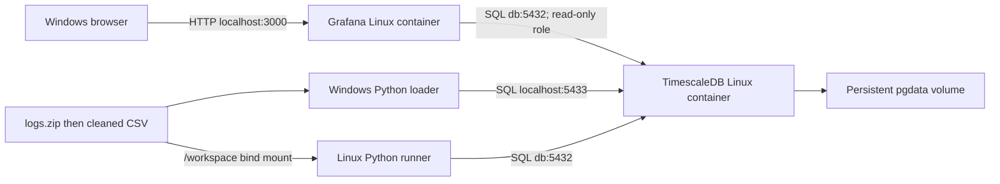

# Deployment and service communication

The mentor confirmed on 17 November 2026 that Docker Desktop on Windows with
Linux containers is acceptable for this project. A separate VirtualBox cluster
is not required. Ubuntu through WSL2 is sufficient for Linux development and
testing. See [issue #12](https://github.com/chpc-tech-eval/switch-squad-hpc-log-viz/issues/12).

| Component | Where it runs | Connection |
|---|---|---|
| Browser | Windows laptop | HTTP to `127.0.0.1:3000` |
| Grafana | Linux container, service `grafana` | PostgreSQL to `db:5432` using SELECT-only `grafana_reader` |
| TimescaleDB | Linux container, service `db` | Internal port 5432; Windows access through `127.0.0.1:5433` |
| Python cleaner and loader | Windows Python 3.13, or Linux `runner` container | Windows loader uses `127.0.0.1:5433`; runner uses `db:5432` |
| Raw logs and cleaned CSVs | Repository folder on Windows | Runner accesses the folder through `/workspace` bind mount |
| Persistent database storage | Docker named volume `pgdata` | Mounted inside database container |

Docker Desktop supplies the Linux environment for the containers. Windows
remains the laptop operating system. Running the Python tools in the Linux
runner exercises Linux execution; using Windows Python runs those tools on
Windows. Ubuntu development through WSL2 is an accepted option, not a claim that
an Ubuntu distribution was used for the recorded Windows checks.

Compose creates a private service network. Containers resolve `db` as the
database service name. Inside Grafana, `localhost` would refer to Grafana itself,
so its datasource uses `db:5432`. From Windows, the published database port is
5433. The browser talks to Grafana, which executes the SQL; it does not connect
directly to PostgreSQL. Docker ports are bound to laptop loopback.

The cleaner produces accepted snapshots and companion quality reports. The
loader writes validated rows using the ingestion account. Grafana reads those
rows through a separate restricted account. Stopping a container does not remove
the named database volume. Reproduction commands are in [workflow.md](workflow.md).
